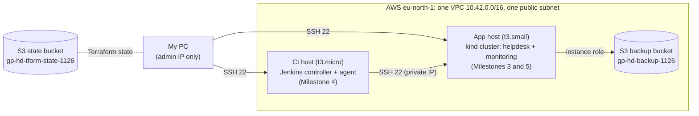

# RT Helpdesk on AWS: DevOps final project

Individual DevOps final project: deploy and operate the supplied RT Helpdesk (Flask + PostgreSQL) on AWS with Docker, Terraform, Kubernetes (kind), Jenkins, Prometheus and Grafana.

The original package README is kept at [docs/SUPPLIED_README.md](docs/SUPPLIED_README.md).

**Status:** Milestones 1-2 done. Milestones 3-5 are placeholders.

## Contents

1. [Architecture](#architecture)
2. [Ports and access](#ports-and-access)
3. [Milestone 1: Container packaging, Git and CI](#milestone-1-container-packaging-git-and-ci)
4. [Milestone 2: AWS with Terraform](#milestone-2-aws-with-terraform)
5. [Milestone 3: Linux and Kubernetes](#milestone-3-linux-and-kubernetes) (todo)
6. [Milestone 4: Jenkins release and rollback](#milestone-4-jenkins-release-and-rollback) (todo)
7. [Milestone 5: Monitoring and restore](#milestone-5-monitoring-and-restore) (todo)
8. [Cleanup and teardown](#cleanup-and-teardown)
9. [Problems met and how they were solved](#problems-met-and-how-they-were-solved)

## Architecture



Built so far: everything in the diagram except what runs on the hosts (Milestones 3-5).

**Known limits.** One app host and one database mean there is no high availability. The kind cluster uses local volumes, which are lost if the cluster (or host) is deleted. Recovery therefore relies on the S3 backups. No load balancer, domain, HTTPS, EKS, RDS or NAT gateway is used, by design (cost and scope).

## Ports and access

| What | Where | Who can reach it |
|---|---|---|
| SSH to CI host | port 22 | my admin IP only (`admin_cidr`) |
| SSH to app host | port 22 | my admin IP, and the CI host's security group |
| Helpdesk UI and API (local Compose) | http://localhost:8000 | my PC only (bound to 127.0.0.1) |
| Prometheus / Grafana (local Compose profile) | localhost:9090 / localhost:3000 | my PC only |
| App, Grafana, Prometheus on AWS | Milestones 3 and 5 | SSH tunnel and `kubectl port-forward` only; no public ports |

My admin IP changes sometimes. If SSH stops working, update `admin_cidr` and run `terraform apply`.

## Milestone 1: Container packaging, Git and CI

### Dockerfile

Three named stages in one `Dockerfile`:

| Stage | Purpose |
|---|---|
| `base` | `python:3.12-slim-bookworm`, creates user/group 10001, installs `requirements.txt`, then copies `app/` and `gunicorn.conf.py` |
| `test` | Extends `base`, adds `requirements-dev.txt`, `pytest.ini` and `tests/`; default command runs pytest; final user is 10001:10001 |
| `runtime` | Extends `base`; sets `APP_VERSION`, `USER 10001:10001`, `EXPOSE 8000`, starts Gunicorn |

`runtime` is the **last** stage, so `docker build` without `--target` produces the web image. `test` extends `base`, not `runtime`, so it is never the default result. Compose, GitHub Actions and Jenkins refer to `runtime` by name.

**Dependency caching.** `requirements.txt` is copied and installed before `app/` is copied. A source-only change (for example a CSS edit) reruns only the `COPY app/` layers. I checked this: after adding a CSS comment the `pip install` layer showed `CACHED`.

**Non-root user.** The image runs as UID/GID 10001 (`app`), with `nologin` and no home directory. Application files are owned by root and are read-only to that user. Verified with `id` inside the container and `docker image inspect` (`10001:10001`).

**Writable `/tmp` and read-only root.** The app only needs `/tmp` (Gunicorn's `worker_tmp_dir`). Compose runs it with `read_only: true` and a `tmpfs` on `/tmp`. I verified that `touch /tmp/...` works with `docker run --read-only --tmpfs /tmp`.

**Runtime secrets.** No credentials are in build arguments, the Dockerfile or image layers. Database settings come from environment variables supplied by Compose from a generated `.env` (git-ignored and Docker-ignored). The only build argument is `APP_VERSION`, which is not a secret. Release images will use the commit SHA.

**Ports and data.** The app listens on 8000 inside the container (`EXPOSE 8000`); Compose publishes it on `127.0.0.1:8000`. The image holds no data. Tickets live in PostgreSQL's named volume `pgdata`, which survives `docker compose restart` and `down` (not `down -v`).

**Why tests stay in the build context but out of the runtime image.** `.dockerignore` filters the context for both targets, and the test target needs `tests/`, `pytest.ini` and `requirements-dev.txt`, so they cannot be ignored. The runtime image stays clean because its stage never copies them. Verified: `pip show pytest` fails in the runtime image.

### .dockerignore

Excludes Git history and editor files, `.env*`, keys and kubeconfigs, virtualenvs, bytecode and test caches, backups, dumps and logs, Terraform state/plans/variable files, and folders neither image needs (`docs/`, `reference/`, `monitoring/`, `postgres/`, `scripts/`). It deliberately keeps `tests/`, `pytest.ini`, `requirements-dev.txt` and `app/schema.sql`. Patterns use `**/` so subfolders are covered. The build context dropped to about 20 kB.

### Local verification results

| Check | Command | Result |
|---|---|---|
| Three builds | `docker build --target runtime ...`, `--target test ...`, plain build | All succeeded |
| Default command | `docker image inspect ... .Config.Cmd` | `["gunicorn","--config","gunicorn.conf.py","app:create_app()"]` |
| Non-root | `docker image inspect ... .Config.User` | `10001:10001` |
| Read-only run | `docker run --read-only --tmpfs /tmp ... touch /tmp/...` | Succeeded; `/app` has only `app`, `gunicorn.conf.py`, `requirements.txt` |
| Runtime has no pytest | `pip show pytest` in runtime image | "Package(s) not found" |
| Baked version | `printenv APP_VERSION` | `packaging-check` |
| Layer caching | CSS change, rebuild | `pip install` layer `CACHED` |
| Compose startup | `docker compose up --build -d` | `db` and `api` healthy; `migrate` exited 0 |
| Tests | `docker compose --profile test run --build --rm tests` | **36 passed**, none skipped |
| Persistence | Create a ticket, `docker compose restart api db` | Ticket still present afterwards |

Note for Windows and Git Bash: commands containing Linux paths like `/tmp` need `MSYS_NO_PATHCONV=1` in front, or Git Bash rewrites them. In PowerShell 5.1, Terraform options containing a dot must be quoted (`"-out=lab.plan"`).

### Git and CI

- Repository: https://github.com/Gal-Peter/rt-helpdesk (public). `.gitignore` excludes `.env`, keys, Terraform state and plans, `terraform.tfvars`, `backend.hcl`, kubeconfigs and backups.
- Workflow `.github/workflows/ci.yml` runs on pull requests, on pushes to `main` and manually.
  - **Tests job:** PostgreSQL service, all tests, builds the runtime image without pushing it, and uploads `test-results` even when a later step fails.
  - **Terraform job:** `terraform fmt -check`, `terraform init -backend=false` and `terraform validate` for `terraform/bootstrap` and `terraform/lab`. The backend is disabled so PR jobs need no AWS credentials.
- Required checks: enforced by a repository ruleset on `main`: a pull request is required, and the 3 CI checks (tests, Terraform bootstrap, Terraform lab) must pass before merging. Force pushes are blocked. Approvals are set to 0 because this is an individual project.

| Run | What happened | Link |
|---|---|---|
| App CI #1 (push to `main`) | **Failed** at "Build runtime image": `open Dockerfile: no such file or directory`. Tests passed; `main` had no Dockerfile yet | [run](https://github.com/Gal-Peter/rt-helpdesk/actions/runs/43119547749) |
| App CI #2 (PR #1) | Passed after adding the Dockerfile and `.dockerignore` | [run](https://github.com/Gal-Peter/rt-helpdesk/actions/runs/43121318752) |
| App CI #3 (merge to `main`) | Passed | [run](https://github.com/Gal-Peter/rt-helpdesk/actions/runs/43122323070) |
| My own deliberately failing test (no fixture was supplied): CI fails, merge blocked | PR #5, first commit | [run](https://github.com/Gal-Peter/rt-helpdesk/actions/runs/43987294930) |
| Failing test removed: CI passes, merge unlocked | PR #5, second commit | [run](https://github.com/Gal-Peter/rt-helpdesk/actions/runs/43988471574) |

Pull requests so far (each self-reviewed with a checklist and merged only after green checks):

1. #1 Dockerfile and `.dockerignore`
2. Terraform bootstrap and lab, plus the Terraform CI job
3. Budget change: track usage excluding credits

## Milestone 2: AWS with Terraform

### What was built

Two Terraform projects, applied in order:

| Project | Creates | State |
|---|---|---|
| `terraform/bootstrap` | One S3 bucket for Terraform state: encrypted (AES256), versioned, all public access blocked, `prevent_destroy` | Local file (git-ignored), backed up privately |
| `terraform/lab` | VPC `10.42.0.0/16`, one public subnet, internet gateway and route, two security groups, key pair, two EC2 hosts, private backup bucket, backup IAM role and instance profile, monthly budget | Remote: the S3 state bucket, with native lock file (`use_lockfile`) |

Inputs (`terraform.tfvars`, git-ignored): region, project name, admin IP (`/32`), SSH public key, backup bucket name, budget email, monthly budget, instance types. Outputs: `ci_public_ip`, `app_public_ip`, `app_private_ip`, `backup_bucket`.

| Setting | Value |
|---|---|
| Region | `eu-north-1` (Stockholm), the only region my free-plan project allows |
| CI host | `t3.micro` (about 0.9 GiB RAM), Ubuntu 24.04 (`ami-084df9e6ad4622caf`), 50 GB encrypted gp3 |
| App host | `t3.small` (about 1.9 GiB RAM), same image and disk |
| Instance metadata | IMDSv2 required (`http_tokens = required`) |
| Backup bucket | `gp-hd-backup-1126`: private, encrypted, objects under `backups/` expire after 14 days |
| State bucket | `gp-hd-tform-state-1126` |

### What the backup IAM role allows

The app host's role can only: list the backup bucket under the `backups/` prefix, and upload (`PutObject`) and download (`GetObject`) objects under `backups/` in that one bucket. It cannot delete objects, touch other buckets, or manage any AWS infrastructure. This is why a stolen instance credential could not damage the rest of the account.

### Commands (PowerShell, from `terraform/bootstrap` then `terraform/lab`)

```powershell
$env:AWS_PROFILE = "rt-lab"          # profile created with: aws login --profile rt-lab --region eu-north-1

# bootstrap (once)
terraform init
terraform plan "-out=bootstrap.plan" "-var=region=eu-north-1" "-var=state_bucket=gp-hd-tform-state-1126"
terraform apply "bootstrap.plan"

# lab
terraform init "-backend-config=backend.hcl"
terraform fmt -recursive
terraform validate
terraform plan "-out=lab.plan"
terraform apply "lab.plan"
terraform output
```

### Results (expected vs actual)

| Step | Expected | Actual |
|---|---|---|
| Bootstrap plan and apply | 4 to add | 4 added |
| Lab plan (reviewed line by line) | 18 to add, 0 destroy | 18 added |
| Second `terraform plan` | No changes | "No changes. Your infrastructure matches the configuration." |
| SSH to both hosts with my key | Login as `ubuntu` | Worked on both |
| SSH from other IPs | Blocked | By security group (only `admin_cidr` allowed) |
| Replace hosts after changing the SSH key | 3 to add, 3 to destroy | As expected; no other resource touched |
| Budget change (`include_credit = false`) | 0 add, 1 change, 0 destroy | As expected |

Provider lock files (`.terraform.lock.hcl`, provider `hashicorp/aws` v6.72.0) are committed so everyone gets the same provider version.

### Budget, credits and cost estimate

- Account: AWS Free plan, **$100 credits** at the start, valid until **May 16, 2027**. Access to services ends when credits run out or the free period ends.
- Budget: **$50 per month**, actual-spend email alert at 80% ($40). It tracks real usage (`include_credit = false`) so credits cannot hide spending. It only notifies; it does not stop resources.
- I check Billing, Credits weekly.

Estimate for running both hosts 24/7 in `eu-north-1` (_rough numbers: confirm each line in the AWS Pricing Calculator before the assessment_):

| Item | Approx. per month |
|---|---|
| `t3.small` + `t3.micro` compute | ~$25 |
| 2 x 50 GB gp3 encrypted disks | ~$8 |
| 2 public IPv4 addresses | ~$7 |
| S3 (state and backups, tiny) | under $1 |
| **Total** | **~$40**, or ~$55 for the six weeks if never stopped |

Stopping an instance saves compute but not disk or IP costs, and the public IP changes when it starts again.

## Milestone 3: Linux and Kubernetes

_Todo._

## Milestone 4: Jenkins release and rollback

_Todo._

## Milestone 5: Monitoring and restore

_Todo._

## Cleanup and teardown

Run only after the assessment and after keeping the evidence I need. Stopping instances is not cleanup.

1. Copy any backups or evidence I want to keep, then empty the backup bucket (it has `force_destroy = false`, so a non-empty bucket blocks destroy):
   ```powershell
   aws s3 rm s3://gp-hd-backup-1126/ --recursive --profile rt-lab
   ```
2. From `terraform/lab`, review what will be removed, then destroy it:
   ```powershell
   terraform plan -destroy
   terraform destroy
   ```
3. The state bucket is protected (`prevent_destroy`) and versioned. Only after the lab is destroyed: remove the `prevent_destroy` lifecycle line in `terraform/bootstrap/main.tf`, empty the bucket including all object versions, then run `terraform destroy` in `terraform/bootstrap`. Do not delete this bucket while resources still depend on it.
4. Verify in the AWS console and with the CLI that nothing remains: EC2 instances, EBS volumes, public IPv4 addresses, security groups, VPC, S3 buckets, IAM roles and the budget.
5. Check Billing for the next days to confirm no new charges.

## Problems met and how they were solved

| Problem | Cause | Fix |
|---|---|---|
| First `terraform apply` failed creating a bucket: explicit deny in a service control policy | My AWS account belonged to an organization that blocks regions; the free-plan project allows only one region | Learned the project region (`eu-north-1`) from the sign-in page and used it everywhere |
| CLI error "login session has expired" | `aws login` sessions are short-lived | `aws login --profile rt-lab --region eu-north-1` again |
| `terraform plan -out=x.plan` gave "Too many command line arguments" | PowerShell 5.1 splits arguments at the dot | Quote the option: `"-out=x.plan"` |
| Lost the passphrase of my first SSH key | A passphrase cannot be recovered | New key pair, then `terraform apply -replace=...` for both (still empty) hosts |
| Git Bash rewrote `/tmp` in a Docker command | MSYS path conversion | Prefix the command with `MSYS_NO_PATHCONV=1` |
| First CI run on `main` failed | `main` had no Dockerfile yet | The Dockerfile PR fixed it |
