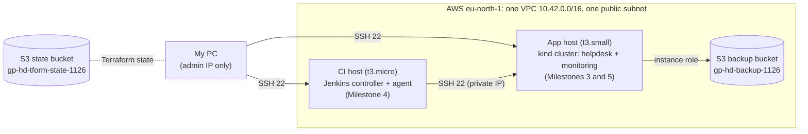

# RT Helpdesk on AWS: DevOps final project

Individual DevOps final project: deploy and operate the supplied RT Helpdesk (Flask + PostgreSQL) on AWS with Docker, Terraform, Kubernetes (kind), Jenkins, Prometheus and Grafana.

The original package README is kept at [docs/SUPPLIED_README.md](docs/SUPPLIED_README.md).

**Status:** Milestones 1-5 done.

## Contents

1. [Architecture](#architecture)
2. [Ports and access](#ports-and-access)
3. [Milestone 1: Container packaging, Git and CI](#milestone-1-container-packaging-git-and-ci)
4. [Milestone 2: AWS with Terraform](#milestone-2-aws-with-terraform)
5. [Milestone 3: Linux and Kubernetes](#milestone-3-linux-and-kubernetes)
6. [Milestone 4: Jenkins release and rollback](#milestone-4-jenkins-release-and-rollback)
7. [Milestone 5: Monitoring and restore](#milestone-5-monitoring-and-restore)
8. [Cleanup and teardown](#cleanup-and-teardown)
9. [Problems met and how they were solved](#problems-met-and-how-they-were-solved)

## Architecture



Built so far: the AWS infrastructure, both hosts, the kind cluster and the app on the app host (Milestone 3), a Jenkins pipeline that tests, builds, publishes and deploys the app, with automatic rollback (Milestone 4), and Prometheus and Grafana monitoring with a database-down alert and a verified S3 backup restore (Milestone 5).

**Known limits.** One app host and one database mean there is no high availability. The kind cluster uses local volumes, which are lost if the cluster (or host) is deleted. Recovery therefore relies on the S3 backups. No load balancer, domain, HTTPS, EKS, RDS or NAT gateway is used, by design (cost and scope).

## Ports and access

| What | Where | Who can reach it |
|---|---|---|
| SSH to CI host | port 22 | my admin IP only (`admin_cidr`) |
| SSH to app host | port 22 | my admin IP, and the CI host's security group |
| Helpdesk UI and API (local Compose) | http://localhost:8000 | my PC only (bound to 127.0.0.1) |
| Prometheus / Grafana (local Compose profile) | localhost:9090 / localhost:3000 | my PC only |
| App, Grafana, Prometheus on AWS | Milestones 3 and 5 | SSH tunnel and `kubectl port-forward` only; no public ports |

My admin IP changes sometimes. If SSH stops working, update `admin_cidr` and run `terraform apply`.

## Milestone 1: Container packaging, Git and CI

### Dockerfile

Three named stages in one `Dockerfile`:

| Stage | Purpose |
|---|---|
| `base` | `python:3.12-slim-bookworm`, creates user/group 10001, installs `requirements.txt`, then copies `app/` and `gunicorn.conf.py` |
| `test` | Extends `base`, adds `requirements-dev.txt`, `pytest.ini` and `tests/`; default command runs pytest; final user is 10001:10001 |
| `runtime` | Extends `base`; sets `APP_VERSION`, `USER 10001:10001`, `EXPOSE 8000`, starts Gunicorn |

`runtime` is the **last** stage, so `docker build` without `--target` produces the web image. `test` extends `base`, not `runtime`, so it is never the default result. Compose, GitHub Actions and Jenkins refer to `runtime` by name.

**Dependency caching.** `requirements.txt` is copied and installed before `app/` is copied. A source-only change (for example a CSS edit) reruns only the `COPY app/` layers. I checked this: after adding a CSS comment the `pip install` layer showed `CACHED`.

**Non-root user.** The image runs as UID/GID 10001 (`app`), with `nologin` and no home directory. Application files are owned by root and are read-only to that user. Verified with `id` inside the container and `docker image inspect` (`10001:10001`).

**Writable `/tmp` and read-only root.** The app only needs `/tmp` (Gunicorn's `worker_tmp_dir`). Compose runs it with `read_only: true` and a `tmpfs` on `/tmp`. I verified that `touch /tmp/...` works with `docker run --read-only --tmpfs /tmp`.

**Runtime secrets.** No credentials are in build arguments, the Dockerfile or image layers. Database settings come from environment variables supplied by Compose from a generated `.env` (git-ignored and Docker-ignored). The only build argument is `APP_VERSION`, which is not a secret. Release images will use the commit SHA.

**Ports and data.** The app listens on 8000 inside the container (`EXPOSE 8000`); Compose publishes it on `127.0.0.1:8000`. The image holds no data. Tickets live in PostgreSQL's named volume `pgdata`, which survives `docker compose restart` and `down` (not `down -v`).

**Why tests stay in the build context but out of the runtime image.** `.dockerignore` filters the context for both targets, and the test target needs `tests/`, `pytest.ini` and `requirements-dev.txt`, so they cannot be ignored. The runtime image stays clean because its stage never copies them. Verified: `pip show pytest` fails in the runtime image.

### .dockerignore

Excludes Git history and editor files, `.env*`, keys and kubeconfigs, virtualenvs, bytecode and test caches, backups, dumps and logs, Terraform state/plans/variable files, and folders neither image needs (`docs/`, `reference/`, `monitoring/`, `postgres/`, `scripts/`). It deliberately keeps `tests/`, `pytest.ini`, `requirements-dev.txt` and `app/schema.sql`. Patterns use `**/` so subfolders are covered. The build context dropped to about 20 kB.

### Local verification results

| Check | Command | Result |
|---|---|---|
| Three builds | `docker build --target runtime ...`, `--target test ...`, plain build | All succeeded |
| Default command | `docker image inspect ... .Config.Cmd` | `["gunicorn","--config","gunicorn.conf.py","app:create_app()"]` |
| Non-root | `docker image inspect ... .Config.User` | `10001:10001` |
| Read-only run | `docker run --read-only --tmpfs /tmp ... touch /tmp/...` | Succeeded; `/app` has only `app`, `gunicorn.conf.py`, `requirements.txt` |
| Runtime has no pytest | `pip show pytest` in runtime image | "Package(s) not found" |
| Baked version | `printenv APP_VERSION` | `packaging-check` |
| Layer caching | CSS change, rebuild | `pip install` layer `CACHED` |
| Compose startup | `docker compose up --build -d` | `db` and `api` healthy; `migrate` exited 0 |
| Tests | `docker compose --profile test run --build --rm tests` | **36 passed**, none skipped |
| Persistence | Create a ticket, `docker compose restart api db` | Ticket still present afterwards |

Note for Windows and Git Bash: commands containing Linux paths like `/tmp` need `MSYS_NO_PATHCONV=1` in front, or Git Bash rewrites them. In PowerShell 5.1, Terraform options containing a dot must be quoted (`"-out=lab.plan"`).

### Git and CI

- Repository: https://github.com/Gal-Peter/rt-helpdesk (public). `.gitignore` excludes `.env`, keys, Terraform state and plans, `terraform.tfvars`, `backend.hcl`, kubeconfigs and backups.
- Workflow `.github/workflows/ci.yml` runs on pull requests, on pushes to `main` and manually.
  - **Tests job:** PostgreSQL service, all tests, builds the runtime image without pushing it, and uploads `test-results` even when a later step fails.
  - **Terraform job:** `terraform fmt -check`, `terraform init -backend=false` and `terraform validate` for `terraform/bootstrap` and `terraform/lab`. The backend is disabled so PR jobs need no AWS credentials.
- Required checks: enforced by a repository ruleset on `main`: a pull request is required, and the 3 CI checks (tests, Terraform bootstrap, Terraform lab) must pass before merging. Force pushes are blocked. Approvals are set to 0 because this is an individual project.

| Run | What happened | Link |
|---|---|---|
| App CI #1 (push to `main`) | **Failed** at "Build runtime image": `open Dockerfile: no such file or directory`. Tests passed; `main` had no Dockerfile yet | [run](https://github.com/Gal-Peter/rt-helpdesk/actions/runs/43119547749) |
| App CI #2 (PR #1) | Passed after adding the Dockerfile and `.dockerignore` | [run](https://github.com/Gal-Peter/rt-helpdesk/actions/runs/43121318752) |
| App CI #3 (merge to `main`) | Passed | [run](https://github.com/Gal-Peter/rt-helpdesk/actions/runs/43122323070) |
| My own deliberately failing test (no fixture was supplied): CI fails, merge blocked | PR #5, first commit | [run](https://github.com/Gal-Peter/rt-helpdesk/actions/runs/43987294930) |
| Failing test removed: CI passes, merge unlocked | PR #5, second commit | [run](https://github.com/Gal-Peter/rt-helpdesk/actions/runs/43988471574) |

Pull requests so far (each self-reviewed with a checklist and merged only after green checks):

1. #1 Dockerfile and `.dockerignore`
2. Terraform bootstrap and lab, plus the Terraform CI job
3. Budget change: track usage excluding credits

## Milestone 2: AWS with Terraform

### What was built

Two Terraform projects, applied in order:

| Project | Creates | State |
|---|---|---|
| `terraform/bootstrap` | One S3 bucket for Terraform state: encrypted (AES256), versioned, all public access blocked, `prevent_destroy` | Local file (git-ignored), backed up privately |
| `terraform/lab` | VPC `10.42.0.0/16`, one public subnet, internet gateway and route, two security groups, key pair, two EC2 hosts, private backup bucket, backup IAM role and instance profile, monthly budget | Remote: the S3 state bucket, with native lock file (`use_lockfile`) |

Inputs (`terraform.tfvars`, git-ignored): region, project name, admin IP (`/32`), SSH public key, backup bucket name, budget email, monthly budget, instance types. Outputs: `ci_public_ip`, `app_public_ip`, `app_private_ip`, `backup_bucket`.

| Setting | Value |
|---|---|
| Region | `eu-north-1` (Stockholm), the only region my free-plan project allows |
| CI host | `t3.micro` (about 0.9 GiB RAM), Ubuntu 24.04 (`ami-084df9e6ad4622caf`), 50 GB encrypted gp3 |
| App host | `t3.small` (about 1.9 GiB RAM), same image and disk |
| Instance metadata | IMDSv2 required (`http_tokens = required`) |
| Backup bucket | `gp-hd-backup-1126`: private, encrypted, objects under `backups/` expire after 14 days |
| State bucket | `gp-hd-tform-state-1126` |

### What the backup IAM role allows

The app host's role can only: list the backup bucket under the `backups/` prefix, and upload (`PutObject`) and download (`GetObject`) objects under `backups/` in that one bucket. It cannot delete objects, touch other buckets, or manage any AWS infrastructure. This is why a stolen instance credential could not damage the rest of the account.

### Commands (PowerShell, from `terraform/bootstrap` then `terraform/lab`)

```powershell
$env:AWS_PROFILE = "rt-lab"          # profile created with: aws login --profile rt-lab --region eu-north-1

# bootstrap (once)
terraform init
terraform plan "-out=bootstrap.plan" "-var=region=eu-north-1" "-var=state_bucket=gp-hd-tform-state-1126"
terraform apply "bootstrap.plan"

# lab
terraform init "-backend-config=backend.hcl"
terraform fmt -recursive
terraform validate
terraform plan "-out=lab.plan"
terraform apply "lab.plan"
terraform output
```

### Results (expected vs actual)

| Step | Expected | Actual |
|---|---|---|
| Bootstrap plan and apply | 4 to add | 4 added |
| Lab plan (reviewed line by line) | 18 to add, 0 destroy | 18 added |
| Second `terraform plan` | No changes | "No changes. Your infrastructure matches the configuration." |
| SSH to both hosts with my key | Login as `ubuntu` | Worked on both |
| SSH from other IPs | Blocked | By security group (only `admin_cidr` allowed) |
| Replace hosts after changing the SSH key | 3 to add, 3 to destroy | As expected; no other resource touched |
| Budget change (`include_credit = false`) | 0 add, 1 change, 0 destroy | As expected |

Provider lock files (`.terraform.lock.hcl`, provider `hashicorp/aws` v6.72.0) are committed so everyone gets the same provider version.

### Budget, credits and cost estimate

- Account: AWS Free plan, **$100 credits** at the start, valid until **May 16, 2027**. Access to services ends when credits run out or the free period ends.
- Budget: **$50 per month**, actual-spend email alert at 80% ($40). It tracks real usage (`include_credit = false`) so credits cannot hide spending. It only notifies; it does not stop resources.
- I check Billing, Credits weekly.

Estimate for running both hosts 24/7 in `eu-north-1` (_rough numbers: confirm each line in the AWS Pricing Calculator before the assessment_):

| Item | Approx. per month |
|---|---|
| `t3.small` + `t3.micro` compute | ~$25 |
| 2 x 50 GB gp3 encrypted disks | ~$8 |
| 2 public IPv4 addresses | ~$7 |
| S3 (state and backups, tiny) | under $1 |
| **Total** | **~$40**, or ~$55 for the six weeks if never stopped |

Stopping an instance saves compute but not disk or IP costs, and the public IP changes when it starts again.

## Milestone 3: Linux and Kubernetes

Both hosts were configured over SSH with the supplied bootstrap script (`reference/linux/bootstrap-ubuntu.sh`), run from a clone of this repository in `/opt/rt-helpdesk`. The app was then deployed to a kind cluster with the supplied manifests and helper scripts. The supplied manifests were used **unchanged** (the script only substitutes the image reference).

### Tool versions

| Item | Version |
|---|---|
| OS | Ubuntu 24.04.5 LTS, kernel 7.0.0-1017-aws |
| Docker / Compose (distro packages) | 29.1.3 / 2.40.3 |
| kind | v0.33.0 (checksum verified by the script) |
| kubectl | v1.34.13 (checksum verified by the script) |
| Kubernetes node image | `kindest/node:v1.34.0` (pinned with `--image`) |
| AWS CLI (app host) | 2.41.0, installed from Amazon's official installer |
| Jenkins (CI host) | 2.580.2 LTS, package held with `apt-mark hold` |
| Java (CI host) | OpenJDK 21 JRE (distro package) |

### Host preparation

- **Swap:** both hosts had no swap, and the CI host has only about 0.9 GB of RAM. I added a 2 GB swap file (`fallocate`, `chmod 600`, `mkswap`, `swapon`, plus an `/etc/fstab` line) so memory pressure slows things down instead of the kernel killing processes. A reboot confirmed it survives restarts. It is slow compared with RAM, so it is a safety net, not capacity.
- **Jenkins heap limit:** a systemd drop-in (`/etc/systemd/system/jenkins.service.d/override.conf`) sets `JAVA_OPTS` with `-Xms128m -Xmx384m`. A drop-in survives package upgrades; editing the unit file would not. Verified in the running process arguments.
- **Inspection:** `systemctl is-active docker jenkins` (both `active`), `systemctl status jenkins`, and `journalctl -u jenkins` (log shows "Jenkins is fully up and running").
- **SSH:** I log in with an ed25519 key pair (the private key stays on my PC and is never committed); port 22 is limited by security group, see [Ports and access](#ports-and-access). The app is reached with `-L 8001:...` (local port 8001, to avoid clashing with the local Compose copy on 8000).

### Linux users

| User | Host | Purpose | Sudo | Docker group |
|---|---|---|---|---|
| `ubuntu` | both | Administration over SSH | yes | yes |
| `buildagent` | CI | Runs Jenkins builds (agent set up in Milestone 4); needs Docker to build images | no | yes |
| `deploy` | app | Release identity: holds a namespace-limited Kubernetes kubeconfig and nothing else | **no** | **no** |

Docker-group membership is effectively root on the host, so it is given only to the accounts that need it. `deploy` was verified: `sudo -l -U deploy` reports no sudo rights and `docker ps` as `deploy` is denied.

### Image used for the first deployment

Built from commit `2181d9dac3ecd476afce05e23f594d08bd489010` on `main` with `APP_VERSION` set to that SHA, pushed to a public GHCR package, and deployed **by digest** so the exact bytes are fixed:

`ghcr.io/gal-peter/rt-helpdesk@sha256:ce5c3a75e9fb2a253532222f9cbde7e5b67d42bae35cf9814c97dc3f6d975d87`

An anonymous `docker pull` of that digest on the app host succeeded (so the package is public), and `printenv APP_VERSION` in the container prints the commit SHA. The same SHA is shown in the app's UI header.

The package is public so Kubernetes needs no image pull secret. The image holds only application code (already public in this repo); all credentials are injected at runtime from Kubernetes Secrets.

### kind cluster

`kind create cluster --name helpdesk --config reference/k8s/kind.yaml --image kindest/node:v1.34.0`: one control-plane node, API server bound to `127.0.0.1:6443` (not reachable from the network). Default StorageClass `standard` (local-path provisioner, reclaim policy `Delete`).

### Kubernetes resources (namespace `helpdesk`)

| Resource | Name | What it does and why |
|---|---|---|
| ConfigMap | `app-config` | Non-secret settings: DB host/port/name/user, `DB_SSLMODE`. `APP_ENV` is patched in by the bootstrap script |
| Secret (created outside Git) | `app-secret`, `db-secret` | Random DB passwords generated at bootstrap time by the script; never written to Git or the image |
| ConfigMap | `db-init` | Init script that creates the non-superuser `helpdesk_app` role and the `helpdesk` schema when PostgreSQL first initializes an empty volume |
| StatefulSet + headless Service | `db` | One PostgreSQL 16 pod with a stable name (`db-0`); the headless Service gives it a stable DNS name. `pg_isready` readiness probe; requests 100m CPU / 256 Mi, limits 1 CPU / 512 Mi |
| PVC (from `volumeClaimTemplates`) | `data-db-0` | 2 Gi volume for the database; survives pod restarts |
| Job | `init-db` | One-time `flask --app app init-db` that creates the tables; retries up to 3 times, 180 s deadline. Not run on every API start |
| Deployment | `api` | 1 replica of the app. Non-root (UID/GID 10001), `readOnlyRootFilesystem`, all capabilities dropped, no privilege escalation, `RuntimeDefault` seccomp, writable `emptyDir` on `/tmp`. Requests 100m / 128 Mi, limits 500m / 256 Mi |
| Probes (on `api`) | | `startupProbe` and `livenessProbe` on `/healthz`; `readinessProbe` on `/readyz`, so a pod is only sent traffic when the app and database are ready |
| Service | `api` | ClusterIP on port 8000; reached only through `kubectl port-forward` over an SSH tunnel |
| ServiceAccount, Role, RoleBinding | `jenkins-release` | The release identity (below) |

Neither the API pod nor the DB pod mounts a service-account token (`automountServiceAccountToken: false`).

### Release identity (least privilege)

`jenkins-release` may only `get`/`watch`/`patch` the Deployment named `api`, `get`/`list` pods, and `create` on `pods/exec` (for the smoke test), all inside `helpdesk`. `reference/scripts/issue-release-kubeconfigs.sh` issues a token valid for 24 hours and writes a kubeconfig to `/home/deploy/.kube/helpdesk` (owner `deploy`, mode 600). **Credentials must be refreshed by re-running that script when they expire.** Cluster-admin credentials are never used by Jenkins.

Tests run as `deploy` with that kubeconfig:

| Command | Result |
|---|---|
| `kubectl get pods` | works |
| `kubectl get secrets` | `Forbidden` (cannot list secrets) |
| `kubectl -n kube-system get pods` | `Forbidden` |
| `docker ps` | permission denied |

### Acceptance checks (2026-11-18)

| Check | Expected | Actual |
|---|---|---|
| Open the app through the tunnel | UI with five seeded tickets | `ssh -L 8001:127.0.0.1:8000` plus `kubectl port-forward service/api 8000:8000`; UI shown at `localhost:8001` with the build SHA in the header |
| Create a ticket | New ticket appears | Ticket #6 (fictional data) created |
| Delete the API pod | A new pod replaces it | Pod `api-55686d6f84-nz8st` deleted; `api-55686d6f84-z7bm7` was `1/1 Running` 14 s later |
| Restart the DB pod with the same PVC | Ticket still there | `db-0` deleted and recreated (PVC `data-db-0` unchanged); ticket #6 still present |
| Diagnose a wrong configuration | Cause found with logs and `describe` | See below |

**Diagnosis exercise.** I set the Deployment image to a tag that does not exist (`kubectl set image deployment/api api=ghcr.io/gal-peter/rt-helpdesk:does-not-exist`). The new pod went to `ErrImagePull` while the old pod stayed `1/1 Running`, because a rolling update only removes the old pod after the new one is ready. `kubectl describe pod` showed the failed image pull in the Events section; `kubectl logs` only said the container was "waiting to start: trying and failing to pull image", because the app never ran. I recovered with `kubectl rollout undo deployment/api` and confirmed one healthy `1/1` pod.

### Limits

- One API replica and one database pod; no high availability. The scaling exercise was not done.
- The PVC lives in kind's local storage on the app host. Deleting the kind cluster or the host loses the data, even though the manifests contain a PVC; recovery relies on the S3 backup (Milestone 5).
- Release credentials expire after about 24 hours and must be re-issued.

### Problems met and how they were solved

| Problem | Cause | Fix |
|---|---|---|
| Bootstrap script stopped on the app host: `Package 'awscli' has no installation candidate` | Ubuntu 24.04 no longer has an `awscli` apt package, and the script uses `set -e` | Everything before that line (Docker, kind, kubectl, `deploy` user) had already run; I installed AWS CLI v2 from Amazon's official zip installer |
| `docker push` ended with `error from registry: denied` | Not diagnosed; all layers uploaded, and the package then appeared as **Private** | Made the GHCR package public in its settings, then verified an anonymous pull of the digest from the app host |
| `kubectl logs` showed nothing useful for the broken pod | The container never started | Used `kubectl describe pod` Events for image-pull errors |

## Milestone 4: Jenkins release and rollback

Jenkins builds, tests, publishes and deploys the app from `main`. The pipeline is the supplied `reference/Jenkinsfile`; I changed only its three environment values (registry repository, registry host, app host address), through a reviewed pull request.

### Setup

| Item | Choice |
|---|---|
| Jenkins | 2.580.2 LTS on the CI host, package held with `apt-mark hold`, heap capped at 384 MB (see Milestone 3) |
| Controller | **0 executors**: no build ever runs on the controller |
| Build agent | SSH agent `helpdesk-build` (label `helpdesk-build`) on the same host, as the unprivileged user `buildagent` (Docker group, no sudo). Its SSH host key was trusted once, when the node was first connected |
| Access to the UI | Only through an SSH tunnel (`-L 8081:127.0.0.1:8080`); port 8080 is not open to the internet |
| Job | `helpdesk-release`: *Pipeline script from SCM*, public repo, branch `*/main`, script path `reference/Jenkinsfile` |

### Credentials (kept in the Jenkins store, never in Git)

| ID | Type | Used for |
|---|---|---|
| `buildagent-ssh` | SSH private key | Controller connects to the build agent |
| `registry-push` | Username and token | `docker push` to GHCR, only inside the publish stage |
| `app-deploy-ssh` | SSH private key (user `deploy`) | Release step connects to the app host |
| `app-known-hosts` | Secret file | `known_hosts` for the app host; the deploy SSH uses `StrictHostKeyChecking=yes` |

The deploy key is restricted on the app host (`authorized_keys` entry with `from=` the CI host's address and `restrict`), and the `deploy` user has no sudo, no Docker group and a namespace-limited kubeconfig. Credentials are used only in the stages that need them, and the pipeline runs `set +x` around them so they are not echoed.

### Pipeline stages

1. **Checkout trusted main**: checks out the repo and fails unless `HEAD` equals `origin/main`.
2. **Required checks on this SHA**: re-runs the tests (`docker compose --profile test run --build --rm tests`) against an isolated PostgreSQL. The pipeline does not trust a status it did not verify itself.
3. **Build image**: `docker build --target runtime` with `APP_VERSION` set to the commit SHA.
4. **Publish immutable release**: pushes the SHA-tagged image to GHCR with a temporary Docker config and records its **digest** in `release-image.txt` (archived).
5. **Deploy and verify**: over SSH as `deploy`, `reference/scripts/release.sh` sets the Deployment to the **digest**, waits for the rollout, checks every pod's `/version` equals the commit SHA and `/readyz` is 200, then creates and reads a ticket through the Service. If any step fails, an `ERR` trap restores the previous image.

`disableConcurrentBuilds`, a 45-minute timeout and 15 kept builds protect a host with under 1 GB of RAM. A `post` block always tears down the test containers and deletes the workspace.

### Results

| Build | Commit | Result | What happened |
|---|---|---|---|
| #1 | `3158ae1` | **Failed, rolled back** | Tests, build and push passed. `kubectl rollout status` was forbidden (see Problems), timed out after 180 s, the rollback trap restored the previous image. The app kept serving from the old pod |
| #2 | `7fa71c0` | **Success** | Tests 36 passed; digest `sha256:7b6cffbc94d7aae6ff126aa9efe0a67bd04fefe78675e282f804b8bde7c7412b`; rollout completed; `Verified helpdesk at 7fa71c06…`. The Deployment's image is that digest |

**Controlled bad release.** I ran the same `release.sh`, as the same `deploy` user, with a well-formed image digest that does not exist (64 zeros). The new pod went `ErrImagePull` / `ImagePullBackOff` while the old pod stayed `1/1 Running`. After the 180 s timeout the script printed `Release failed; restoring previous image`, set the previous digest back and reported `successfully rolled out`. Afterwards the Deployment showed the build #2 digest again and one healthy pod.

Evidence kept with the submission: console output of builds #1 and #2, `release-image.txt`, screenshots of the credentials list (IDs only), node status and the rollback test, and the `kubectl` outputs above.

### Problems met and how they were solved

| Problem | Cause | Fix |
|---|---|---|
| Build #1 deploy stage hung and then rolled back: `cannot list resource "deployments"... forbidden` | The supplied Role gave `jenkins-release` only `get`, `watch` and `patch` on the `api` Deployment, and `kubectl rollout status` also needs `list` | Added one line, `list`, to the Deployment rule in `reference/k8s/release-rbac.yaml` via a pull request. The rule still has `resourceNames: [api]`, so Jenkins cannot list or change any other Deployment. Applied with `kubectl apply`; `kubectl auth can-i list deployments.apps/api --as=…` gives `yes`, and for all Deployments `no` |
| A secret-file credential was created with a random ID | The ID field was left blank | Deleted it and recreated it with the ID `app-known-hosts`, which the Jenkinsfile expects |

### Limits

- The bad-release test ran `release.sh` directly, not through a Jenkins build, so that a deliberately broken commit would not enter `main`. It tests the same script and identity the pipeline uses.
- Release credentials last 24 hours; before a release on a later day, run `reference/scripts/issue-release-kubeconfigs.sh` on the app host again.
- Docker warns that BuildKit/buildx is not installed and uses the legacy builder. It works; installing buildx would be an improvement.
- One agent, one executor: builds are queued, not parallel.

## Milestone 5: Monitoring and restore

Prometheus and Grafana run in the `monitoring` namespace of the kind cluster, deployed with the supplied script and manifests (`reference/scripts/bootstrap-monitoring.sh`, `reference/k8s/monitoring.yaml`). Scrape config, alert rule and dashboard JSON are in Git (`reference/k8s/prometheus.yml`, `alerts.yml`, `helpdesk-dashboard.json`) and are loaded into ConfigMaps by the script. The Grafana admin password is entered at deploy time (at least 16 characters, hidden) and stored only in a Kubernetes Secret.

### Access

| What | How | Port exposed to the internet |
|---|---|---|
| Grafana | `ssh -L 3001:127.0.0.1:3000` to the app host, then `kubectl -n monitoring port-forward service/grafana 3000:3000`; browse `http://localhost:3001` | none |
| Prometheus | `ssh -L 9091:127.0.0.1:9090`, then `kubectl -n monitoring port-forward service/prometheus 9090:9090`; browse `http://localhost:9091` | none |

### How Prometheus finds the app

Kubernetes service discovery (`role: pod`, limited to the `helpdesk` namespace). Only pods labelled `app=api`, in phase `Running`, with a container port named `http` are scraped. The supplied Role lets the `prometheus` ServiceAccount read pods in that namespace only. Scrape interval is 15 s.

Check: `up{job="helpdesk"}` returned one series (the API pod) with value `1`.

### Dashboard: three panels

| Panel | Query (supplied) | What it tells me |
|---|---|---|
| Reachable targets | `sum(up{job="helpdesk",environment="helpdesk"})` | How many app pods Prometheus can scrape. `1` means the one API pod is reachable |
| API requests per second | `sum(rate(helpdesk_http_requests_total{...,route=~"/api/.*"}[5m]))` | Traffic reaching the API, averaged over 5 minutes |
| API 5xx percentage | 5xx request rate divided by total request rate, times 100 | Share of API requests that failed on the server side |

I generated load with the supplied `scripts/traffic.py --seconds 180` (read-only GETs, about four per second) through a port-forward to the `api` Service. The panels showed "No data" for the two request panels before traffic, then the request rate rose toward the generated rate and the 5xx percentage stayed at 0 %, because no request failed.

### Alert: database unavailable

Rule `HelpdeskDatabaseUnavailable`: `helpdesk_database_up{job="helpdesk"} == 0`, `for: 1m`, severity `critical`. No notification channel is configured; the state is read in the Prometheus UI.

| Step | Command | Expected | Actual |
|---|---|---|---|
| Baseline | open `/alerts` | rule Inactive | Inactive |
| Stop the database (2026-11-23 23:26:36 UTC) | `kubectl -n helpdesk scale statefulset/db --replicas=0` | `db-0` stops, PVC stays | `db-0` gone, `data-db-0` kept; the `api` pod became `0/1 Running` with no new restarts |
| Wait | refresh `/alerts` | Pending, then Firing after 1 minute of failures | **Firing**, value 0, "Active since 3m 43s" in my screenshot |
| Restart the database | `kubectl -n helpdesk scale statefulset/db --replicas=1` | `db-0` returns with the same data, API becomes ready | `db-0` `1/1`, `api` `1/1`, all 7 tickets still present |
| Recovery | refresh `/alerts` | Inactive again | **Inactive** |

**Liveness vs readiness.** `/healthz` (liveness) only says the process is alive, so it stayed healthy and Kubernetes did not restart the pod. `/readyz` (readiness) checks the database, so it failed and the pod was removed from the Service. Restarting the app would not bring the database back, so keeping the pod and failing readiness is the right behaviour.

### Backup to S3 and verified restore

| Step | Command | Result |
|---|---|---|
| Record tickets before | `psql ... -c 'SELECT id,title,status FROM helpdesk.tickets ORDER BY id;'` into a file | 7 tickets |
| Backup and upload | `bash reference/scripts/k8s-backup.sh helpdesk <backup bucket>` | `Backup uploaded: backups/helpdesk/20261123T233945Z.dump` |
| Confirm in S3 | `aws s3 ls s3://<backup bucket>/backups/helpdesk/` | one object, 4446 bytes |
| Download | `aws s3 cp s3://<backup bucket>/backups/helpdesk/20261123T233945Z.dump restored.dump` | file of the same size |
| Restore into a new database | `createdb ... helpdesk_restore_check1`, then `pg_restore --no-owner --no-privileges --exit-on-error` | no errors |
| Compare | `SELECT id,title,status ...` on the restored database, `diff` with the saved list | **IDENTICAL** (7 rows, including the Hebrew-titled ticket) |
| Clean up | `dropdb ... helpdesk_restore_check1`, `rm restored.dump` | only `helpdesk`, `postgres` and the templates remain; live `helpdesk` still has 7 tickets |

The backup uses the EC2 instance role (no access keys on the host). The role can write backups but not delete them, the bucket is private, and objects expire after 14 days. The restore never touched the application's database.

### Limits

- One API replica and one database pod. The alert detects an outage; it does not prevent one.
- Prometheus and Grafana data and the database volume live in kind's local storage on one host. Deleting the cluster or the host loses them; the S3 backup is the recovery path for the tickets (dashboards and rules are in Git).
- The backup is manual, not scheduled (the scheduled extension is optional).
- The restore test ran inside the same PostgreSQL server (a new database next to the live one), not on a fresh server. That proves the dump is valid and complete; a full disaster recovery would also rebuild the cluster and database pod first.
- The alert has no email or chat notification.

## Cleanup and teardown

Run only after the assessment and after keeping the evidence I need. Stopping instances is not cleanup.

1. Copy any backups or evidence I want to keep, then empty the backup bucket (it has `force_destroy = false`, so a non-empty bucket blocks destroy):
   ```powershell
   aws s3 rm s3://gp-hd-backup-1126/ --recursive --profile rt-lab
   ```
2. From `terraform/lab`, review what will be removed, then destroy it:
   ```powershell
   terraform plan -destroy
   terraform destroy
   ```
3. The state bucket is protected (`prevent_destroy`) and versioned. Only after the lab is destroyed: remove the `prevent_destroy` lifecycle line in `terraform/bootstrap/main.tf`, empty the bucket including all object versions, then run `terraform destroy` in `terraform/bootstrap`. Do not delete this bucket while resources still depend on it.
4. Verify in the AWS console and with the CLI that nothing remains: EC2 instances, EBS volumes, public IPv4 addresses, security groups, VPC, S3 buckets, IAM roles and the budget.
5. Check Billing for the next days to confirm no new charges.

## Problems met and how they were solved

| Problem | Cause | Fix |
|---|---|---|
| First `terraform apply` failed creating a bucket: explicit deny in a service control policy | My AWS account belonged to an organization that blocks regions; the free-plan project allows only one region | Learned the project region (`eu-north-1`) from the sign-in page and used it everywhere |
| CLI error "login session has expired" | `aws login` sessions are short-lived | `aws login --profile rt-lab --region eu-north-1` again |
| `terraform plan -out=x.plan` gave "Too many command line arguments" | PowerShell 5.1 splits arguments at the dot | Quote the option: `"-out=x.plan"` |
| Lost the passphrase of my first SSH key | A passphrase cannot be recovered | New key pair, then `terraform apply -replace=...` for both (still empty) hosts |
| Git Bash rewrote `/tmp` in a Docker command | MSYS path conversion | Prefix the command with `MSYS_NO_PATHCONV=1` |
| First CI run on `main` failed | `main` had no Dockerfile yet | The Dockerfile PR fixed it |
